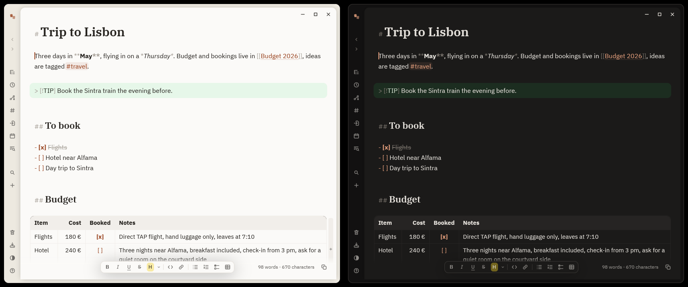
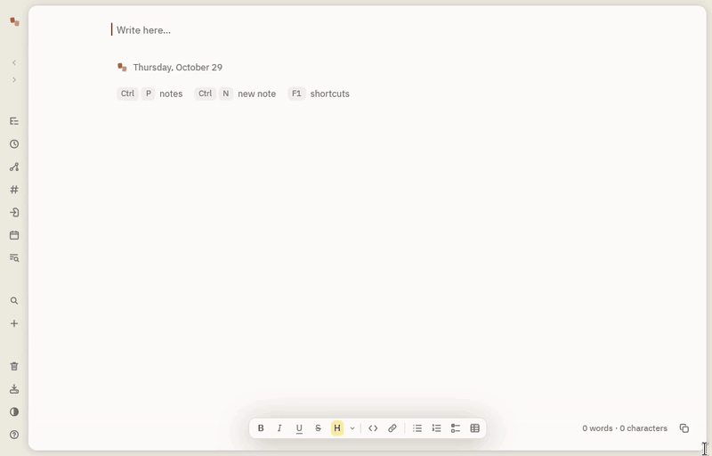

# Bref

[](https://github.com/alarboulletmarin/bref/actions/workflows/ci.yml)
[](https://github.com/alarboulletmarin/bref/releases/latest)
[](LICENSE)

A fast, minimal note-taking app. Notes are plain Markdown files in a folder you choose, styled as you type. Written in Rust with [GPUI](https://www.gpui.rs), a GPU-accelerated UI framework.



**[Install](#install)** · **[User guide](book/src/introduction.md)** · [Shortcuts](book/src/shortcuts.md) · [Website](https://alarboulletmarin.github.io/bref/) · [Contributing](CONTRIBUTING.md)

## Why Bref

- **Fast.** The window opens in about 75 ms. A keystroke costs about a millisecond, even in a note of 5,000 lines. [Figures](book/src/performance.md)
- **Plain files.** One `.md` file per note, in an ordinary folder. Sync it with git, Syncthing or a cloud folder. An existing folder of Markdown notes works as is.
- **Styled as you type.** Headings grow, bold and italics render, markers stay visible but dimmed. The file on disk stays plain Markdown.
- **Tables that compute.** Cells wrap, `Tab` moves between them, pasting from a spreadsheet works, and `=sum(above)` adds up a column.
- **Linked notes.** `[[Links]]`, backlinks, tags, embedded sections, a graph, and a calendar of daily notes.
- **More than notes.** Kanban boards, list pages built from front matter, UML diagrams drawn by hand and saved as SVG, and a CSV grid that opens a million rows.
- **Agents.** `bref mcp` lets an agent read, write and draw in the vault, with Bref's links, trash and diagrams. [Guide](book/src/agents.md)
- **Keyboard first.** One palette for notes and commands. Every shortcut is listed in the app (`F1`) and can be changed.
- **Yours to dress.** 13 themes, IBM Plex built in, any installed font. Light and dark, English and French.



## Install

| System | Get it |
|---|---|
| Arch Linux | the prebuilt package, below |
| macOS 11 or later | [`bref-macos.dmg`](https://github.com/alarboulletmarin/bref/releases/latest/download/bref-macos.dmg) |
| Windows 10 or 11 | [installer](https://github.com/alarboulletmarin/bref/releases/latest/download/bref-windows-x86_64-setup.exe) or [zip](https://github.com/alarboulletmarin/bref/releases/latest/download/bref-windows-x86_64.zip) |
| Ubuntu, Debian, Fedora, other Linux | build from source, below |

```bash
# Arch Linux
curl -LO https://github.com/alarboulletmarin/bref/releases/latest/download/bref-x86_64.pkg.tar.zst
sudo pacman -U ./bref-x86_64.pkg.tar.zst
```

```bash
# Other Linux: needs Rust 1.88 or later, and the libraries listed in the install guide
git clone https://github.com/alarboulletmarin/bref.git
cd bref
make && sudo make install
```

The macOS and Windows downloads are not signed. The first launch needs one extra click: see [the install guide](book/src/install.md), which also covers the packages of each distribution, building on macOS and Windows, and upgrading.

Bref tells you when a new version is out. On Arch, macOS and Windows (installer), one click updates it.

## Getting started

1. Launch Bref and click **Start in ~/Documents/Notes**, or open a folder you already have.
2. Type. The first line is the title of the note and the name of its file. Saving is automatic.
3. `Ctrl + P` finds or creates a note, `F10` lists every command, `F1` lists every shortcut.

On macOS, read `Cmd` for `Ctrl`. More in [First steps](book/src/first-steps.md).

## Documentation

The [user guide](book/src/introduction.md) covers everything. It is also published as a website: [alarboulletmarin.github.io/bref/guide](https://alarboulletmarin.github.io/bref/guide/).

| Page | What it covers |
|---|---|
| [Writing notes](book/src/writing.md) | Markdown, styles, lists, slash commands, blocks, several cursors |
| [Tables and formulas](book/src/tables.md) | tables in notes, grips, formulas, very large tables |
| [Links, embeds and files](book/src/links.md) | links, backlinks, tags, embedded sections, pictures, dropped files |
| [Comments](book/src/comments.md) | annotating a passage, in a format other apps read |
| [Daily notes, templates and capture](book/src/daily-notes.md) | today's note, the calendar, templates, quick capture |
| [The palette and the panel](book/src/navigation.md) | the tree, the graph, the trash, icons |
| [Tabs, panes and docks](book/src/tabs-and-panes.md) | arranging the window |
| [Search and replace](book/src/search.md) | in a note, and in the whole vault |
| [Kanban boards and list pages](book/src/boards.md) | a note as a board, a folder as a table |
| [Diagrams](book/src/diagrams.md), [UML diagrams](book/src/uml.md) | the canvas, Mermaid, import, every UML notation |
| [CSV and TSV files](book/src/csv.md) | the grid |
| [Files on disk](book/src/vault.md) | naming, front matter, backup, configuration files |
| [Syncing a vault](book/src/sync.md) | git in one key, or a cloud folder |
| [Settings and appearance](book/src/settings.md) | themes, fonts, page width, changing a shortcut |
| [Updates](book/src/updates.md) | how Bref updates itself, and what it sends |
| [Keyboard shortcuts](book/src/shortcuts.md) | every shortcut, as the help panel lists them |
| [Agents (MCP)](book/src/agents.md) | `bref mcp`: an agent reads, writes and draws in the vault |
| [Compatibility](book/src/compatibility.md), [Troubleshooting](book/src/troubleshooting.md), [Performance](book/src/performance.md) | systems, known problems, measurements |

## Contributing

Bug reports and small fixes are welcome. For a feature, open an issue first. Read [CONTRIBUTING.md](CONTRIBUTING.md) and the map of the code, [ARCHITECTURE.md](ARCHITECTURE.md). For a security problem, see [SECURITY.md](SECURITY.md).

## License

[MIT](LICENSE)
