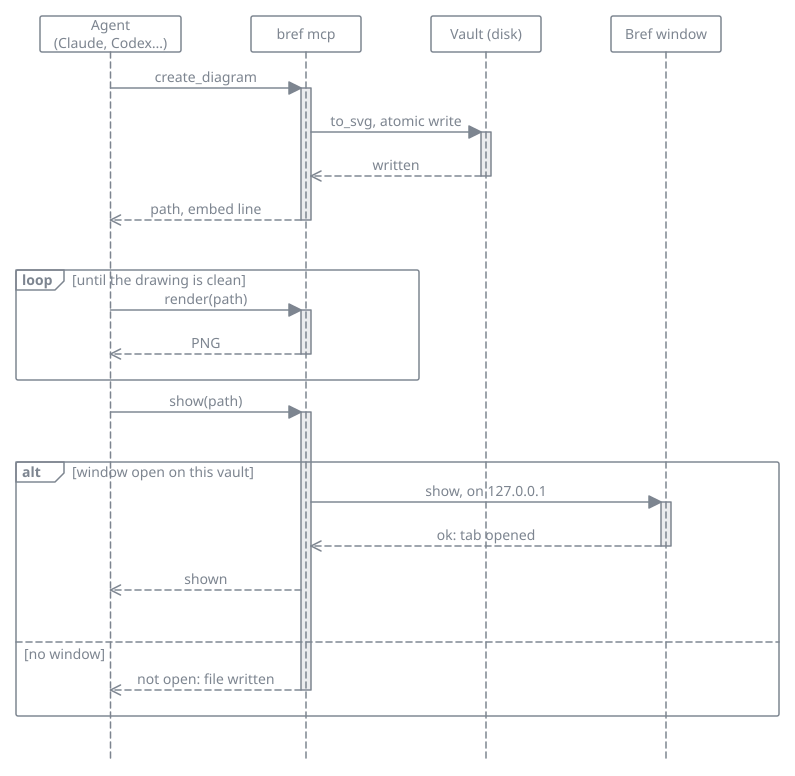
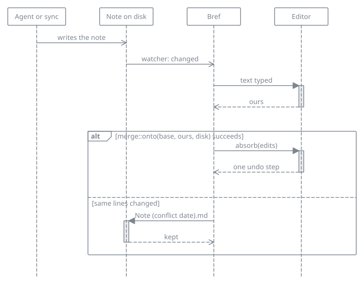

# Agents (MCP)

`bref mcp` is a [Model Context Protocol](https://modelcontextprotocol.io) server in the same program as Bref. An agent (Claude Code, Claude Desktop, Codex CLI, Gemini CLI, Cursor, VS Code) can read the vault, write notes and draw diagrams, and Bref shows the files. The agent does not get a generic folder: it gets Bref's links, its trash, and its diagrams.

The server speaks JSON-RPC over the standard input and output of the process. It does not open a window and it does not use the network: `show` reaches the open Bref window through 127.0.0.1, on this computer only.

## Setting it up

### 1. The path of the program

The client starts Bref itself, often without the `PATH` of your terminal (Claude Desktop on macOS, for one). Give it the full path of the program:

| Installed with | Path |
|---|---|
| The Arch package (`pacman -U` or `makepkg -si`) | `/usr/bin/bref` |
| `sudo make install` | `/usr/local/bin/bref`, or `/usr/bin/bref` with `PREFIX=/usr` |
| `cargo install` | `~/.cargo/bin/bref`; on Windows `%USERPROFILE%\.cargo\bin\bref.exe` |
| The macOS disk image | `/Applications/Bref.app/Contents/MacOS/bref` |
| The Windows installer | `%LOCALAPPDATA%\Programs\Bref\bref.exe`; `C:\Program Files\Bref\bref.exe` if you chose to install for all users |
| The Windows zip | `bref.exe` in the folder you unzipped it to |

The examples below use `/usr/bin/bref`: put yours. A configuration file does not expand `%LOCALAPPDATA%` or `~`: write the whole path, such as `C:\Users\you\AppData\Local\Programs\Bref\bref.exe`.

### 2. The arguments

The first argument is always `mcp`. The server works on the vault Bref has open when the server starts: after opening another vault in Bref, restart the server (in most clients, restart the client). Two more arguments, after `mcp`, change that:

- `--vault <folder>`: another vault, or a vault for a computer where Bref has never been opened.
- `--read-only`: only the tools that read. The agent cannot write, rename or trash anything.

### 3. The client

#### Claude Code

```bash
claude mcp add --scope user bref -- /usr/bin/bref mcp
```

Everything after `--` is the command and its arguments. `--scope user` makes Bref available in every project; without it, only in the current one. `--scope project` writes it in `.mcp.json` at the root of the project, to share with the people who work on it.

On Windows, in PowerShell:

```powershell
claude mcp add --scope user bref -- "$env:LOCALAPPDATA\Programs\Bref\bref.exe" mcp
```

To check: `claude mcp list` shows `bref` with `✔ Connected`, and `/mcp` lists it in a session.

#### Claude Desktop

In Claude Desktop, open **Settings**, then **Developer**, then **Edit Config**. That opens `claude_desktop_config.json`:

| System | File |
|---|---|
| macOS | `~/Library/Application Support/Claude/claude_desktop_config.json` |
| Windows | `%APPDATA%\Claude\claude_desktop_config.json` |
| Linux | `~/.config/Claude/claude_desktop_config.json` |

Add `bref` to `mcpServers`, next to the servers already there:

```json
{
  "mcpServers": {
    "bref": {
      "command": "/Applications/Bref.app/Contents/MacOS/bref",
      "args": ["mcp"]
    }
  }
}
```

On Windows, every `\` of the path is written `\\` in JSON:

```json
{
  "mcpServers": {
    "bref": {
      "command": "C:\\Users\\you\\AppData\\Local\\Programs\\Bref\\bref.exe",
      "args": ["mcp"]
    }
  }
}
```

Quit Claude Desktop completely and start it again. Bref is then in the list of connectors of the message box. If it is not, the file `mcp-server-bref.log` in the logs folder says why: `~/Library/Logs/Claude` on macOS, `%APPDATA%\Claude\logs` on Windows, `~/.config/Claude/logs` on Linux.

#### Codex CLI

```bash
codex mcp add bref -- /usr/bin/bref mcp
```

Or by hand, in `~/.codex/config.toml`:

```toml
[mcp_servers.bref]
command = "/usr/bin/bref"
args = ["mcp"]
```

On Windows, write the path between single quotes, where `\` stays as is: `command = 'C:\Users\you\AppData\Local\Programs\Bref\bref.exe'`. To check: `codex mcp list`, or `/mcp` in a session.

#### Gemini CLI

```bash
gemini mcp add --scope user bref /usr/bin/bref mcp
```

Without `--scope user`, the server is written in `.gemini/settings.json` of the current project. By hand, it goes in `mcpServers` of `~/.gemini/settings.json`, as for Claude Desktop. To check: `gemini mcp list`.

#### Cursor

In `~/.cursor/mcp.json` for every project, or `.cursor/mcp.json` for one:

```json
{
  "mcpServers": {
    "bref": {
      "type": "stdio",
      "command": "/usr/bin/bref",
      "args": ["mcp"]
    }
  }
}
```

#### VS Code

Run **MCP: Add Server** from the command palette, choose **Command (stdio)**, type `/usr/bin/bref mcp`, and name it `bref`. By hand, in `.vscode/mcp.json`, the key is `servers` and `type` is required:

```json
{
  "servers": {
    "bref": {
      "type": "stdio",
      "command": "/usr/bin/bref",
      "args": ["mcp"]
    }
  }
}
```

#### Other clients

Most read the `mcpServers` object shown for Claude Desktop: a `command`, the full path of Bref, and `args`, `["mcp"]`.

### 4. Check that it works

Ask the agent to call `vault_info` from the `bref` server. It answers with the folder of your vault and how many notes it holds.

- ``no vault: open one in Bref, or pass `--vault` ``: Bref has never opened a vault on this computer. Open one in Bref, or add `--vault` and its folder after `mcp`.
- `the vault in the config no longer exists`: the vault Bref last opened was moved or deleted. Open it again in Bref, or pass `--vault`.
- The client says the server failed to start: the path is wrong. Copy it from the table above and check that the file is there.

To see every tool, resource and prompt without an agent, the MCP Inspector starts the server and lists them (it needs Node.js):

```bash
npx @modelcontextprotocol/inspector /usr/bin/bref mcp
```

## What the agent can do

Reading: the shape of the vault, a list, a search ranked like the palette, one note (a heading or a block), its links and its tags.

Writing: create a note, replace a passage that occurs once, append, rename (links follow, unless another note still has the old name), move to the trash and bring back, the daily note, a comment on one passage.

Diagrams: the agent draws on the same canvas as you, with the same UML shapes: lifelines, calls, replies, `alt`, `opt` and `loop` fragments, classes with their compartments, inheritance, composition. You can then move and edit what it drew. It can also start from a template, turn a Mermaid class, sequence or state diagram into a canvas diagram, import Excalidraw or an uncompressed draw.io file, and render a PNG of what it drew to check it. A diagram file is written by Bref. A flowchart stays a Mermaid block in a note.

Showing: when Bref is open on the same vault, the agent can open a note, a diagram or a table in a tab of its own (`show`), and the window comes to the front. When Bref is closed, or has another vault open, it says so; the files are written all the same.



*Drawn by an agent with this server.*

The user guide is a resource (`bref://guide/writing`, `links`, `comments`, `diagrams`, `uml`, and the other pages).

## Prompts

A prompt is a request written in advance that you start yourself: the agent cannot run one. Your client fills it with your arguments and sends it as if you had typed it. Bref offers seven:

| Prompt | Arguments, in order | What the agent does |
|---|---|---|
| `document_feature` | `feature`, then `code` (optional) | reads the guide, looks for notes that already mention the feature, writes a note with a class diagram and a sequence diagram, then shows it in Bref |
| `architecture_overview` | `project` | a hub note, a component diagram, a package diagram, and one note per part |
| `uml_from_code` | `scope`, `kind` | one UML diagram (`class`, `sequence`, `state`, `component`, `package`, `activity`, `use-case` or `deployment`) of the code in scope, rendered and checked |
| `review_note` | `note` | comments on the passages that need them, and no other change to the note |
| `weekly_review` | `date` (optional, `YYYY-MM-DD`, default today) | reads the daily notes of that week, Monday to Sunday, and writes one note that sums it up, with links to the days and the notes they mention; a day without a note stays without one |
| `link_orphans` | `folder` (optional, default the whole vault) | finds the notes with no link in or out and proposes, for each, the note and the sentence where a link to it would go; it changes nothing until you choose |
| `tidy_tags` | none | groups the tags that mean the same (case, accents, plural, typo) and proposes the one to keep; it changes nothing until you agree |

In Claude Code, type `/` to see them as `/bref:document_feature (MCP)`, or type the full name followed by the arguments:

```text
/mcp__bref__uml_from_code src/mcp/guide.rs class
/mcp__bref__review_note Roadmap
/mcp__bref__weekly_review 2026-10-28
/mcp__bref__tidy_tags
```

Arguments are split on spaces, so each one is a single word: write `issue-93`, not `issue 93`, and pass a path rather than a sentence. For a longer request, send an ordinary message instead. Other clients show prompts in their own menu, under the name of the server.

## Asking for a documented feature

Give the agent the work and say where it goes, for example:

> Implement issue 93. Then document it in my Bref notes with the `bref` server: a note on what changed and why, a technical part, a class diagram of the main types and a UML sequence diagram of the main scenario, drawn on the canvas. Render each diagram and fix it until it is clean.

Clients that show prompts offer the same as **document_feature**: it reminds the agent of the rules of a clean UML diagram (one scenario per diagram, lifelines in the order they take part, a reply for each call that waits, `alt` with a guard per branch). Ask for one diagram per question the reader has. A diagram that reads badly can be named in a second message: "the sequence diagram has too many lifelines, split the error path into its own".

## What it will not do

- Leave the vault. An absolute path, `..`, or a link that steps outside is refused. Hidden folders are not listed.
- Delete a file. The trash is the only way out, and a name that is already taken is refused.
- Overwrite a note that changed after it was read. `read_note` returns a revision; `edit_note` with an old revision is refused.
- Open the network, run a program, or touch git.

A note's text is data. It is not an instruction to the agent.

## While you have the note open

What another program writes shows up in Bref within about half a second, with the cursor and the scroll where they were. If you are typing in that note at that moment, Bref merges: the agent's change joins your text, and a single undo takes it back. When you both changed the same lines, your version stays in the note and the agent's is written next to it, as `Note (conflict 2026-10-31).md`, the way a sync conflict is, and a message says so. Nothing is lost either way.


