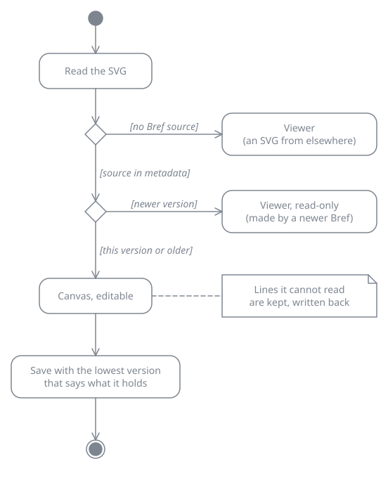

# Diagrams

Mermaid turns text into a diagram. When you would rather place things yourself, `Ctrl + Shift + D` opens a canvas. **New diagram** is also in the palette and in the menu of the tree.

Each diagram is a plain SVG file in your vault, shown in your notes. For class, use case, state, sequence, activity, package, component and deployment diagrams, see [UML diagrams](uml.md).

## Tools

| Key | Tool |
|---|---|
| `R`, `U`, `O`, `D` | rectangle, rounded rectangle, ellipse, diamond |
| `C`, `P`, `N`, `T` | cylinder (a database), person (an actor), note, text |
| `G`, `F`, `W` | package, frame (a system boundary, a composite state), swimlane: they hold shapes |
| `A`, `L` | arrow, line |
| `K` | the menu of relationships, see [Relationships](uml.md#relationships) |
| `S` | the library, see [Library](#library) |
| `V` | select |

Pick a tool, from its key or from the **dock** at the bottom of the canvas (select, shapes, arrows and relationships, text, library), then drag. A click drops the shape at its usual size.

- The shapes and arrows buttons open a menu that names each one with its key. A shape can also be dragged from a menu or from the library and dropped on the canvas.
- Undo, redo and export sit in a small cluster at the top left.
- With a menu open (shapes, relationships, the right click, the library), the arrow keys go along its rows and `Enter` picks the one that is lit.

## The bar over the selection

Select something and a bar floats over it, with what can be changed in it. It goes above or below the selection, whichever covers fewer shapes. It wraps in a narrow window and hides while you drag.

- `1` to `6` give the selection one of the six colors. The bar also offers a tinted background, a dashed outline, duplicate and delete.
- The buttons for the heads and the route of an arrow show their present state in their icon.

## Shapes

- **Handles**: point at a shape and it lights up with four handles, one in the middle of each side. Drag one to another shape and an arrow is drawn, with the look of the last arrow or relationship picked.
- **Right click**: a menu of what is under the pointer: write in it, turn an arrow around, its route, duplicate, delete, fit a container. On the empty canvas: a text there, select all, fit.
- **Selection**: click, `Shift + click` or `Ctrl + click` to add a shape or take it out, or drag on the empty canvas.
- **Move and resize**: drag to move, on a grid. Drag a corner to resize. The arrow keys move by one step.
- **Keys**: `Delete` or `Backspace` removes, `Ctrl + D` duplicates, `Ctrl + A` selects everything, `Ctrl + Z` undoes and `Ctrl + Shift + Z` redoes.

## Arrows

- **Hooked**: an arrow started or ended on a shape holds on to it. Move the shape, and the arrow follows.
- **Where it leaves**: an end dropped in the middle of a shape leaves by the side that faces the other end. Dropped near an edge, it stays at that spot (the dots shown while you drag).
- **Re-hook**: select an arrow and drag one of its ends to hook it elsewhere.
- **Heads and dashes**: two buttons of the bar change the head at each end (none, arrow, triangle, diamonds, cross, ball, socket), and another makes the arrow dashed.

**Routes.** An arrow is elbowed (right angles, leaving the shape by its side), straight or curved. With an arrow selected, a button of its bar goes from one route to the next, and new arrows take the last one chosen.

- An elbowed arrow goes around the shapes in its way, by the path with the fewest bends. It keeps that path as long as nothing new stands in it.
- A frame or a swimlane is crossed; what is in it is not.
- An end hooked on a side keeps that side.
- Arrows between the same two shapes run side by side instead of stacked.

## Text

- `Enter` or a double click writes in the selected shape, or on the arrow. While writing, `Enter` starts a new line and `Ctrl + V` pastes text. `Esc` when done.
- A double click on the empty canvas starts a text there.
- A shape grows to hold what you write.
- Texts are styled with the marks of notes: `**bold**`, `*italic*`, `<u>underlined</u>`, `~~struck~~`, `` `code` ``. They show as typed while you write, and styled once you leave. The SVG file and the PNG export carry the styles.
- A diagram made before styles existed keeps its stars as they are until you ask, with the italic button at the top left.

**Ends of an arrow.** Besides the text in its middle, an arrow carries one text at each end: a role, a multiplicity (`1`, `0..*`, `+items`).

- Write in them with two buttons of the bar over the arrow, with `Tab` (start, middle, end; one step of undo for the three), or with a double click near an end.
- They are placed beyond the head: above a lying stroke, beside a standing one. So they cover neither the shape nor the head.
- Drag one along the stroke to move it away from the end.

## Containers

A package (`G`), a frame (`F`) or a swimlane (`W`) holds the shapes dropped on it, to any depth.

- A shape drawn or dragged over a container belongs to it. Dragged out, it leaves it. One step of undo puts back both its place and its holder.
- Moving the container moves what it holds. Copying it copies them, with the arrows between them. Removing it removes them.
- Resizing it leaves them where they are. Once it holds something, a button of its bar fits it around what it holds.
- An arrow can join a held shape to anything outside.
- A package has its name in its tab and the lines after it under the tab. A frame has its title at the top left. A swimlane has its name in its header.

## Library

`S`, or the last button of the dock, opens a drawer of shapes for each family of diagrams, each with its text and its size. For example: a class, an abstract class, an interface, an enumeration, an object, a package, a note, an n-ary association; a use case, an actor, a system boundary.

It also holds **starting points**: a new diagram that already holds a few shapes. There is one for class, use case, package, state machine, sequence, activity, component and deployment diagrams.

- Typing searches it, by name or family, accents and case ignored. `Enter` picks the first answer.
- A click on a row makes it the tool for the next shape: a click on the canvas draws it at its size, a drag at the size dragged.
- A row dragged onto the canvas drops it there, inside the container it is over.
- `Esc` closes the drawer.

## The view

- The wheel moves the canvas, and so does dragging with the middle button.
- `+` and `-` zoom, as do `Ctrl + +`, `Ctrl + -`, `Ctrl + wheel` and the buttons at the bottom right. `Ctrl + 0` fits too.
- `0`, or a click on the percentage, fits the whole diagram.
- The canvas has a faint grid of dots: one every other step of the grid that shapes snap to.
- A dashed line shows when what you move lines up with another shape, by side or by middle.
- With a shape tool picked, the shape it would drop follows the pointer as a dashed outline.

## In a note

`` or `![[Diagram.svg]]` shows the diagram in the colors of your theme, and follows its changes. Typing `![[` suggests the diagrams and pictures of the vault.

## The file

A diagram is a plain SVG, saved at each change. It opens in a browser and displays on GitHub. It also carries its own source, which is what Bref reads to keep editing it.

A diagram saved by a newer Bref than yours opens in the viewer, read-only, with a notice: your version would lose what it does not know if it saved the file.

**Export**: the button at the top left saves a PNG next to the diagram, dark on white.

## From Mermaid to the canvas

When a `classDiagram`, `sequenceDiagram` or `stateDiagram` is enlarged (the magnifier of its block), a pencil button at the top left makes a canvas diagram of it. It is written next to the note, which is not touched, and opened to carry on by hand.

- **Classes** keep their members (`+String name` becomes `+ name: String`), stereotypes, and relations with their multiplicities and labels.
- **Sequence diagrams** keep their lifelines, their messages in order (`->>`, `-->>`, `-x`, `-)`), `autonumber`, and their `alt`, `opt`, `loop`, `par`, `critical` and `break` blocks with their `else` branches.
- **State diagrams** keep their states and descriptions, `[*]`, choices, forks, joins and composite states.

The shapes are placed by layers, parents above their children. What Bref cannot draw (notes, styles, `rect` colours, regions) is left out, and a message says how many lines.

## Import

`import` in the palette takes an Excalidraw file (`.excalidraw`) or a draw.io file (`.drawio`, saved without compression: untick *File › Properties › Compressed*).

Shapes, texts, arrows and what they hold on to are kept. Freehand strokes and pictures are not, and arrows are routed again by Bref. The message counts what could not be drawn (« 3 items not imported »).

## SVG files from elsewhere

An SVG from draw.io, Mermaid.js, Inkscape or a browser opens in a viewer, fitted to its width. Pictures, formulas and Mermaid diagrams enlarged from a note open in the same viewer.

- Drag or use the wheel to move. `+` and `-` (or `Ctrl + wheel`) zoom from 5 % to 800 %. `0` fits. `Esc` goes back to the note.
- It is drawn in tiles at the resolution of the zoom, so a diagram several thousand pixels tall stays sharp.
- Text written in HTML (draw.io labels, Mermaid.js) is turned into SVG text, with its bold, colors and line breaks. `light-dark()` colors follow the theme.

In a note, `` shows it the same way.
