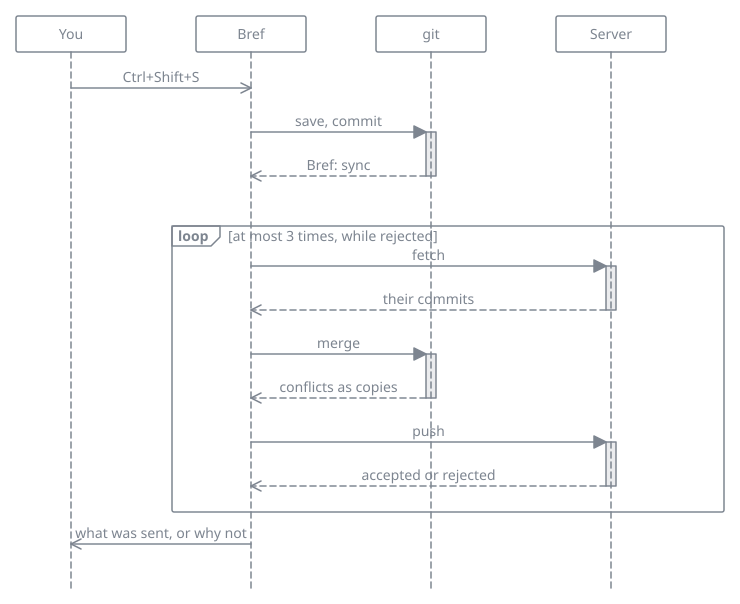

# Syncing a vault

A vault is a folder of plain files. There are two ways to have the same notes on every computer, safely copied somewhere else. Pick one, never both: a git repository inside a cloud folder ends up corrupted.

## With a cloud folder

Put the vault in a folder synced by iCloud, Dropbox, Google Drive or Syncthing. Bref [follows what changes there](vault.md#changes-from-other-programs). Nothing more is needed.

## With git

`Ctrl + Shift + S`, or **Sync the vault** in the palette, does everything in the background while you keep typing:

1. The open notes are saved, and everything that changed is committed, with the message `Bref: sync`.
2. What the server has is fetched and merged.
3. The result is sent. If another computer pushed in the meantime, Bref fetches and merges again, three times at most, then asks you to try again.

A message says what was sent and received, or why it failed. The sync button of the rail turns while it runs; a red dot says the last sync failed.

### Conflicts

- Two computers that changed different notes, or different parts of the same note, are merged without a question.
- When the same lines changed on both sides, both versions are kept, as Dropbox and Syncthing do. The note keeps the version of this computer. The other one is written next to it as `Note (conflict 2026-10-09 laptop).md`, and the sync completes.
- You never get `<<<<<<<` markers in a note.
- A note deleted on one side and edited on the other stays, edited.
- A note renamed on one side and edited on the other is a conflict two copies cannot settle: the sync stops, changes nothing, and asks you to merge with git yourself.
- Line endings are never converted.

### A vault not in git yet

The same command asks for the address of an *empty* repository. Create one on GitHub, GitLab or Codeberg, or on any server you reach by SSH with `git init --bare notes.git`. Bref then connects the vault and sends its notes.

The trash (`.trash`) is left out of the repository, through a `.gitignore`. A repository that already has a history is not overwritten.

### On another computer

**Clone a vault from a git address…**, in the palette or on the welcome screen, asks for the address and a folder, then opens the clone as the vault. The vault's folder is named after the last part of the address, without `.git`, and must not exist yet.

### Requirements

- `git` must be installed, and able to reach the repository without asking anything: an SSH key, or a credential helper for HTTPS.
- Bref never shows a password prompt: ssh runs in batch mode, unless you set `GIT_SSH_COMMAND` yourself. A refused sign-in is reported.
- Without `git`, the sync says so.
- Without a name and an email in the git configuration, the commits are signed `Bref`.

### What it refuses

Bref refuses to sync, says why, and touches nothing, when it finds:

- a merge or a rebase in progress;
- a detached HEAD;
- a branch that follows no branch of the server;
- a locked index;
- a vault that is only a folder of a larger repository.

### Limits

- Syncing happens when you ask, not on a timer, nor when quitting.
- git syncs computers. There is no Bref on a phone, where the repository stays readable with another app.
